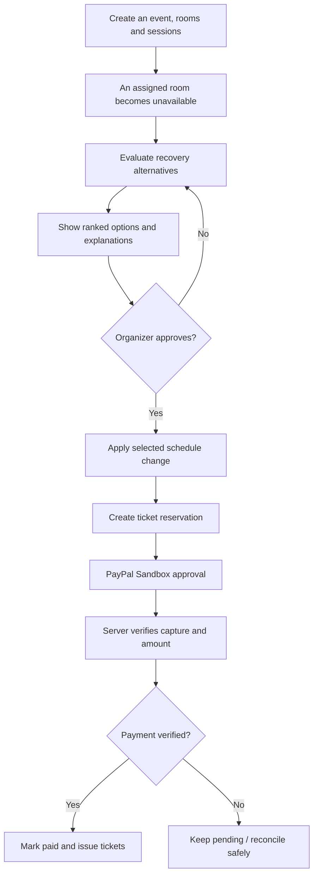
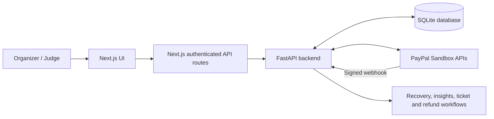

<div align="center">

# EventMesh AI

### Predict. Prevent. Perfect.

**An intelligent event-operations workspace for explainable scheduling recovery, organizer-approved decisions, ticket management, and verified PayPal Sandbox payments.**

**PayPal AI Hackathon 2026** · **Next.js + FastAPI + SQLite + PayPal Sandbox**

[](https://eventmesh-frontend-a1c5.onrender.com/)
[](https://youtu.be/cm-nEzB0UDw?si=wlATPqXxb9vd-Gvy)
[](https://github.com/saksham2806/eventmesh-ai)
[](LICENSE)

</div>

---

## 🔗 Important links

| Resource | Link |
| --- | --- |
| **Live EventMesh website** | **https://eventmesh-frontend-a1c5.onrender.com/** |
| **Organizer login** | **https://eventmesh-frontend-a1c5.onrender.com/login** |
| **YouTube project demo** | **https://youtu.be/cm-nEzB0UDw?si=wlATPqXxb9vd-Gvy** |
| Source code | https://github.com/saksham2806/eventmesh-ai |

> **For reviewers:** Start with the [live website](https://eventmesh-frontend-a1c5.onrender.com/), sign in using the **demo organizer credentials** below, and follow the [guided walkthrough](#-recommended-judge-walkthrough). The YouTube video also demonstrates the project if the hosted environment is being redeployed.

## 🎬 Video walkthrough

[](https://youtu.be/cm-nEzB0UDw?si=wlATPqXxb9vd-Gvy)

**[▶ Watch EventMesh AI — full demo on YouTube](https://youtu.be/cm-nEzB0UDw?si=wlATPqXxb9vd-Gvy)**

---

## 🔑 Demo access — important for hackathon judges

**EventMesh uses one designated organizer account for the hosted judging/demo experience.** Please use the following credentials on the **original live website**:

| Field | Demo credential |
| --- | --- |
| **Login page** | **https://eventmesh-frontend-a1c5.onrender.com/login** |
| **Email** | **`xyz@gmail.com`** |
| **Password** | **`123456789rud`** |

**Why are these specific credentials provided?**

1. **Reproducible judge access.** Everyone reviewing the hosted project can use the same disposable organizer account without registering a new account.
2. **SQLite can reset on Render.** The application currently stores its SQLite database on the service's **ephemeral filesystem**. Restarts and redeployments can remove the database, including previously registered organizers.
3. **Bootstrap account on an empty database.** The FastAPI deployment supports `EVENTMESH_BOOTSTRAP_ORGANIZER_EMAIL` and `EVENTMESH_BOOTSTRAP_ORGANIZER_PASSWORD`. When configured, these values can recreate the designated organizer **if there are no organizer accounts** after database initialization.
4. **Controlled demo workflow.** Public registration is intended to remain disabled on the hosted production-mode frontend, avoiding reliance on newly created accounts that could disappear after a reset.
5. **Easy recovery after data loss.** Even when events and reservations disappear, reviewers can sign in again using the designated demo account **provided the Render bootstrap variables are still configured correctly**.

> [!IMPORTANT]
> **These credentials are deliberately public for a sandbox hackathon demonstration.** They are **not private, secure production credentials**. Anyone who reads this public README can try to access the demo organizer account and modify demo data. Do not reuse them for personal services, live payments, production deployments, or accounts with real user information. Rotate or disable them after judging. If the hosted database already contains a different organizer, the bootstrap process does not necessarily replace that account.

**Note:** The organizer login is **not** a PayPal buyer login. PayPal checkout testing requires a separate **PayPal Sandbox personal buyer account**, not real PayPal credentials.

---

## 🌍 The problem

Running an event is more than creating a calendar. A single room outage, overlapping session, capacity issue, or interrupted payment can trigger a chain of operational problems. Traditional workflows often scatter scheduling, recovery decisions, tickets, and payment reconciliation across separate tools.

**EventMesh AI combines these workflows in one organizer-controlled workspace:** understand a disruption, evaluate alternatives, approve a recovery plan, and verify financial outcomes before issuing tickets.

## 💡 What EventMesh AI does

| Capability | How it helps |
| --- | --- |
| **Event management** | Create and manage organizer-owned events, rooms, sessions, and ticket categories. |
| **Visual scheduling** | Explore sessions and rooms using **Bryntum Scheduler Community**. |
| **Explainable recovery** | Evaluate and rank feasible alternatives when a room becomes unavailable or a schedule needs adjustment. |
| **Human-in-the-loop approval** | Show proposed recovery actions and their reasoning before the organizer approves changes. |
| **Operational insights** | Visualize event activity, scheduling, inventory, and other summaries with **Recharts**. |
| **Ticket reservations** | Create reservations tied to events and ticket quantities. |
| **PayPal Sandbox orders and capture** | Create an order, accept Sandbox approval, verify the capture, and issue tickets only when payment is confirmed. |
| **Refund management** | Support refund proposals, approval, Sandbox execution, and reconciliation. |
| **Webhook observability** | Verify PayPal webhook signatures and inspect recorded notification events. |
| **Organizer authorization** | Use login sessions and ownership checks for organizer-facing operations. |

### Example: a disruption-to-resolution workflow



**Why this matters:** EventMesh prioritizes **explainability and organizer control** rather than silently changing an event schedule or treating a PayPal approval screen as proof that a payment was completed.

## 🧠 AI and decision support — transparency

The recovery workflow uses **constraint-aware evaluation and explainable ranking** to propose alternatives for operational disruptions. It considers the available event context and presents recommendations for an organizer to approve. Changes are **not automatically committed solely because the system recommends them**.

The repository also exposes optional `OPENROUTER_API_KEY` and `OPENROUTER_MODEL` configuration variables. **Those variables alone do not prove an external language model is running in the hosted demo.** When an external model is enabled, identify the actual model/provider and demonstrate the input/output in the submission; do not misrepresent deterministic recovery logic as a verified LLM integration.

---

## 🧱 Technology stack

| Layer | Technology |
| --- | --- |
| Frontend | **Next.js 16, React, TypeScript** |
| Event scheduling UI | **Bryntum Scheduler Community** and React integration |
| Charts and insights | **Recharts** |
| Backend API | **Python, FastAPI, Uvicorn, HTTPX** |
| Database | **SQLite** (`backend/events.db` by default in local development) |
| Payment provider | **PayPal REST APIs — Sandbox only** |
| Webhooks | PayPal webhook signature verification |
| Authentication | Organizer sessions, server-side credentials, event ownership checks |
| Hosting | **Render**, separate frontend and backend web services |
| Optional model integration | Configurable OpenRouter credentials/model, when implemented and enabled |

### System architecture



**Server-side secrets stay on the server.** PayPal client secrets and the shared organizer integration key must never be exposed through `NEXT_PUBLIC_` environment variables or committed into Git.

---

## ⚠️ Why does our database keep getting cleared?

**Short answer:** This is a limitation of **where SQLite is stored on Render**, not a problem caused by SQLite's query engine or a deliberate deletion by the EventMesh UI.

### What happens

- SQLite stores records in a **file on the backend service's filesystem**. In local development that file is commonly `backend/events.db`.
- Render web services use an **ephemeral filesystem by default**. Files created or modified at runtime are not guaranteed to survive a **redeployment or instance restart**.
- On **Render Free**, the service additionally **spins down after 15 minutes without traffic**; that also discards runtime filesystem changes.
- After the next startup, EventMesh may create a **fresh SQLite database**. The new database starts without previous events, sessions, ticket reservations, capture records, webhook logs, or newly registered organizers.
- A **bootstrap organizer** can be recreated from Render environment variables **when the database has no organizers**, but **that does not restore event or payment history**.

| Situation | Can the temporary SQLite data disappear? |
| --- | --- |
| Running locally, same `events.db` file retained | Normally remains until the file is deleted/replaced |
| Render Free sleeps from inactivity | **Yes** — local runtime changes are lost |
| Render redeploys a new version | **Yes**, without persistent storage |
| Render service restarts or instance is replaced | **Yes**, without persistent storage |
| Upgrading to Render Starter | **Still possible** — Starter stops inactivity sleep, **not filesystem resets** |
| Render paid service with persistent disk, correct DB path | Data under the disk mount survives normal restarts/deploys, subject to backups and operational limits |

### Why we intentionally use a fixed demo organizer

Because the project is a **hackathon prototype using temporary SQLite storage**, we chose a single designated demo login instead of asking every judge to create and later lose a new organizer account. Render environment variables survive ordinary application redeployments, so the app can seed the designated organizer again **when the database is empty**. The specified credentials are provided in the [Demo access](#-demo-access--important-for-hackathon-judges) section.

**This is a demonstration convenience, not a permanent authentication or data-persistence solution.** The published password must be rotated after the hackathon.

### How to make data durable in the future

For a deployment that needs permanent event and payment records:

1. Attach a **Render persistent disk** to a **paid backend service**.
2. Mount it at `/var/data` and set `EVENTMESH_DB_PATH=/var/data/events.db` on **the backend**.
3. Redeploy, initialize/migrate the schema safely, and verify database read/write permissions.
4. Maintain backups and test recovery. A persistent disk does **not** retroactively recover records already lost from ephemeral storage.
5. For a larger multi-instance application, consider migrating to a managed relational database such as PostgreSQL rather than continuing with a single-file SQLite deployment.

See: [Render — Free instance behavior](https://render.com/docs/free) · [Render — Persistent disks](https://render.com/docs/disks) · [Render — Deploys and ephemeral storage](https://render.com/docs/deploys).

> [!WARNING]
> **Do not use temporary SQLite as a durable payments ledger.** PayPal may retain an order or capture on its side even after Render loses EventMesh's corresponding local reservation record. For this project, payments are **Sandbox-only** and tests should start with a fresh reservation. Do not blindly repeat capture or refund calls after a reset; verify the remote transaction and reconcile it first.

---

## 🚀 Run EventMesh locally

### Prerequisites

- Git
- **Node.js 20.9+** and npm (Next.js 16)
- **Python 3.11+** and pip
- Two terminals (one for FastAPI, one for Next.js)
- A browser
- Optional for full payment testing: a [PayPal Sandbox business app and personal buyer account](https://developer.paypal.com/dashboard/applications/sandbox)

### 1. Clone the repository

```bash
git clone https://github.com/saksham2806/eventmesh-ai.git
cd eventmesh-ai
```

### 2. Install and configure the FastAPI backend

**Windows PowerShell — Terminal 1:**

```powershell
cd backend
py -3 -m venv .venv
.\.venv\Scripts\python.exe -m pip install --upgrade pip
.\.venv\Scripts\python.exe -m pip install -r requirements.txt
Copy-Item .env.example .env
```

Edit `backend/.env` (this file stays private):

```dotenv
EVENTMESH_ORGANIZER_KEY=YOUR_LONG_RANDOM_SERVER_SECRET
EVENTMESH_ENABLE_REGISTRATION=true
PAYPAL_CLIENT_ID=YOUR_SANDBOX_CLIENT_ID
PAYPAL_CLIENT_SECRET=YOUR_SANDBOX_CLIENT_SECRET
PAYPAL_WEBHOOK_ID=
OPENROUTER_API_KEY=
OPENROUTER_MODEL=
```

- Use **the same** `EVENTMESH_ORGANIZER_KEY` in the frontend configuration.
- Leave optional PayPal/model keys empty if you are only exploring scheduling; the complete payment flow requires valid **Sandbox** credentials.
- `EVENTMESH_ENABLE_REGISTRATION=true` is intended for **local development**, not the public hosted service.
- Do **not** commit `.env`, `.env.local`, `events.db`, API secrets, or session cookies.

Start the API:

```powershell
.\.venv\Scripts\python.exe -m uvicorn main:app --host 127.0.0.1 --port 8000
```

Check: **http://127.0.0.1:8000/health** and (where enabled) **http://127.0.0.1:8000/docs**.

**macOS/Linux alternative:**

```bash
cd backend
python3 -m venv .venv
source .venv/bin/activate
python -m pip install -r requirements.txt
cp .env.example .env
# Edit .env before continuing
python -m uvicorn main:app --host 127.0.0.1 --port 8000
```

### 3. Install and configure Next.js

Open **Terminal 2** at the repository root:

```powershell
cd frontend
npm ci
Copy-Item .env.local.example .env.local
```

Edit `frontend/.env.local`:

```dotenv
EVENTMESH_BACKEND_URL=http://127.0.0.1:8000
EVENTMESH_ORGANIZER_KEY=YOUR_LONG_RANDOM_SERVER_SECRET
```

Start the frontend:

```powershell
npm run dev -- --webpack
```

Open **http://localhost:3000**.

> If `npm ci` fails because of a dependency lockfile/platform mismatch, inspect the error and dependency versions before using `npm install`. Do not commit a changed lockfile accidentally.

### 4. Create a local organizer and explore

1. Enable local registration as described above.
2. Visit **http://localhost:3000/register** to create a **local** organizer, then sign in at **http://localhost:3000/login**.
3. Create an event, add rooms and sessions, and review the visual schedule.
4. Trigger an unavailable-room scenario and inspect the recovery options and reasoning.
5. Approve a recovery proposal and inspect the updated schedule.
6. Create ticket types and a fresh reservation; if configured, test PayPal **Sandbox** checkout and verify the actual capture result.

**Local database and hosted database are separate.** A local organizer account is not automatically available on the hosted Render service; hosted judging should use the designated [demo credentials](#-demo-access--important-for-hackathon-judges).

### 5. Run checks

**Backend, from `backend/`:**

```powershell
.\.venv\Scripts\python.exe -m unittest discover -s . -p "test_*.py"
```

**Frontend, from `frontend/`:**

```powershell
npx tsc --noEmit
npm run build
```

For older SQLite databases created before organizer ownership was introduced, consult the repository's `migrate_event_ownership.py` and back up the database first. Do not blindly run ownership migration on a multi-organizer database.

---

## ☁️ Deploy on Render

The hosted demonstration uses **two independent Render web services** from the same GitHub repository. Both should deploy the **tested `main` branch**.

### Backend service — FastAPI

| Setting | Value |
| --- | --- |
| Service name | `eventmesh-backend` |
| Root directory | `backend` |
| Language/runtime | Python |
| Build command | `pip install -r requirements.txt` |
| Start command | `python -m uvicorn main:app --host 0.0.0.0 --port $PORT` |
| Health URL | `https://eventmesh-backend.onrender.com/health` |

Configure **private Render environment variables**:

```dotenv
EVENTMESH_ORGANIZER_KEY=YOUR_PRIVATE_SHARED_SERVER_SECRET
EVENTMESH_BOOTSTRAP_ORGANIZER_EMAIL=YOUR_DESIGNATED_DEMO_EMAIL
EVENTMESH_BOOTSTRAP_ORGANIZER_PASSWORD=YOUR_DESIGNATED_DEMO_PASSWORD
EVENTMESH_ENABLE_REGISTRATION=false
EVENTMESH_PUBLIC_FRONTEND_URL=https://eventmesh-frontend-a1c5.onrender.com
PAYPAL_CLIENT_ID=YOUR_SANDBOX_CLIENT_ID
PAYPAL_CLIENT_SECRET=YOUR_SANDBOX_CLIENT_SECRET
PAYPAL_WEBHOOK_ID=YOUR_ACTUAL_SANDBOX_WEBHOOK_ID_IF_CONFIGURED
```

The designated demo email and password above correspond to those displayed in the **Demo access** section. They are **demo-only**; the actual Render values must match for reliable re-creation after an empty-database startup. If the backend is already configured correctly, do not replace working values just to follow this document.

Without a persistent disk, leave `EVENTMESH_DB_PATH` unset for the temporary demonstration database. To preserve SQLite records, attach a disk and set it to `/var/data/events.db` as documented earlier.

### Frontend service — Next.js

| Setting | Value |
| --- | --- |
| Service name | `eventmesh-frontend` |
| Root directory | `frontend` |
| Runtime | Node.js (Node 22 used in the documented Render setup) |
| Build command | `npm install --no-audit --no-fund && npm run build` |
| Start command | `npm run start -- --hostname 0.0.0.0 --port $PORT` |
| Public URL | `https://eventmesh-frontend-a1c5.onrender.com` |

The build command above matches the repository's documented hosted workaround for a cross-platform npm lockfile issue; prefer `npm ci` when the lockfile is validated.

Set **private Render environment variables**:

```dotenv
EVENTMESH_BACKEND_URL=https://eventmesh-backend.onrender.com
EVENTMESH_ORGANIZER_KEY=THE_EXACT_SAME_SECRET_AS_THE_BACKEND
EVENTMESH_ENABLE_PRODUCTION_BRIDGE=true
EVENTMESH_PUBLIC_FRONTEND_URL=https://eventmesh-frontend-a1c5.onrender.com
EVENTMESH_ENABLE_PRODUCTION_SANDBOX_CHECKOUT=true
```

**Deployment cautions:**

- Keep `EVENTMESH_ORGANIZER_KEY` identical on the two Render services; it is **not** the public demo password.
- The production API bridge and Sandbox checkout flags are explicit opt-ins. Enable them only after validating the allowed routes, organizer-session checks, same-origin protections, and backend URL.
- Keep the **original frontend domain** as `EVENTMESH_PUBLIC_FRONTEND_URL` for PayPal return/cancel URLs. A temporary PR preview with a different domain will not share the original site's login/checkout cookies.
- Public organizer registration should remain disabled on the hosted demo. The bootstrap variables create a designated organizer **only if the database is empty of organizers**.
- Credentials and PayPal keys belong in **Render Environment**, not source code.

### About Render Free, Starter, and hackathon credits

- **Free:** Web services can sleep after 15 minutes of inactivity. The first request may take time to wake them.
- **Paid Starter:** Prevents inactivity sleep; use paid compute for **both** frontend and backend if you require a continuously running review demo. Paid compute **does not** make local SQLite files persistent.
- **Credits:** If promotional Render credits have been applied to your workspace, eligible charges may be offset by those credits. Track the remaining balance and any expiry in **Render → Billing**; credits are not a guarantee against charges beyond the available balance.
- **Persistent disk:** Optional additional resource for permanent SQLite data; not required for a disposable hackathon demo. See the [Render docs](https://render.com/docs/disks).

### Publishing README changes without resetting demo data

If Render is configured for **automatic deployment on commits to `main`**, even a documentation-only push can trigger a redeploy and erase an ephemeral SQLite database. To update only this README **without initiating Render's automatic redeploy**, use Render's documented commit-message marker:

```bash
git add README.md
git commit -m "docs: improve hackathon README [skip render]"
git push origin main
```

This marker skips an **automatic** Render deploy for that commit; it does not disable manual deploys or guarantee data durability. Always check the Render Events/Deploys page after pushing. See [Render's documentation on skipping auto-deploys](https://render.com/docs/deploys#skipping-an-auto-deploy).

---

## 💳 PayPal Sandbox: payment, confirmation and refunds

EventMesh integrates with **PayPal Sandbox REST APIs** to demonstrate the transaction lifecycle. **No real-money payments are part of this demonstration.**

### Expected checkout lifecycle

1. An authenticated organizer creates an event and ticket reservation.
2. The backend creates a **PayPal Sandbox order** linked to the reservation.
3. A separate PayPal **Sandbox buyer** approves the order.
4. PayPal redirects to the **configured original frontend domain**.
5. The organizer completes the confirmation/capture step when prompted.
6. The backend verifies the PayPal order and capture outcome, amount, and matching reservation before marking payment complete.
7. Tickets are issued only after payment is verified; uncertain outcomes should be reconciled rather than blindly retried.

**A PayPal `CHECKOUT.ORDER.APPROVED` event or approval page is not proof of capture.** A successful reservation should report values such as:

```json
{
  "reservation_status": "PAID",
  "payment_verified": true,
  "tickets_issued": 2,
  "quantity": 2
}
```

The ticket count is an example: the actual count must match the paid reservation quantity. The exact API payload may include other fields.

### Monitoring and refunds

- **Webhook dashboard:** https://eventmesh-frontend-a1c5.onrender.com/webhooks
- **Webhook verification:** PayPal signature verification occurs server-side before an event is trusted and recorded.
- **Refund workflow:** The application includes proposal, approval, Sandbox refund execution, and reconciliation mechanisms where corresponding captured Sandbox transactions exist.
- **Reset warning:** If a deployment reset removes the local transaction record, the backend cannot infer that an old order was paid merely from its previous approval. Verify the actual PayPal provider state before retrying or refunding.

### Why payment may return to the login screen in a preview

PayPal return/cancel URLs depend on `EVENTMESH_PUBLIC_FRONTEND_URL`. If checkout begins at `eventmesh-frontend-pr-2.onrender.com` but redirects to `eventmesh-frontend-a1c5.onrender.com`, browser login and checkout cookies **do not cross domains**. For end-to-end payment demos, use the **original hosted URL throughout**; do not change a shared backend's return origin just to test a temporary preview.

---

## 🧭 Recommended judge walkthrough

> **Approximate route:** Open the hosted application → sign in → create an event → examine schedule → preview recovery → approve a decision → test a Sandbox reservation and payment → inspect verification and webhook insights.

1. **Launch:** Open the [live website](https://eventmesh-frontend-a1c5.onrender.com/).
2. **Sign in:** Use the **highlighted demo email/password** above. A new organizer sign-up is not required.
3. **Event operations:** Create a sample event and add a room, sessions, and ticket inventory.
4. **See the plan:** Open the Bryntum schedule and explore Insights charts.
5. **Simulate a disruption:** Mark a room unavailable and review explained recovery recommendations.
6. **Approve:** Choose an alternative and observe how the schedule changes.
7. **Reserve:** Create a new ticket reservation using fake attendee details.
8. **Pay:** If using a PayPal Sandbox buyer, follow the approval **and** capture-confirmation steps. Never use a real PayPal buyer account.
9. **Verify:** Check `PAID`, `payment_verified=true`, and the correct ticket quantity; inspect webhook history when Sandbox events are available.
10. **Optional:** Explore the refund/reconciliation workflow for an eligible captured Sandbox payment.

**If the demo database was reset:** Just sign in using the designated demo credentials again and create a fresh event. Previously entered data may no longer exist. The project video provides a repeatable walkthrough independent of any one temporary database snapshot.

---

## 🛠️ Troubleshooting

| Symptom | Likely cause | Suggested check |
| --- | --- | --- |
| Site initially slow to load | Render Free cold start | Check whether **both** services use Starter for an always-on demo; otherwise allow startup time. |
| `Authentication service unavailable` | Backend unreachable, proxy error, or startup failure | Check backend `/health`, frontend/server logs, the trusted backend URL, and matching integration key. |
| Backend `/health` is healthy but login fails | Session, origin, demo account, or credentials issue | Check the login API status, `EVENTMESH_PUBLIC_FRONTEND_URL`, and bootstrap organizer environment variables. |
| Organizer account disappeared | Ephemeral SQLite DB recreated | Ensure bootstrap demo credentials are configured; sign in again after initialization. |
| Events, tickets, or history disappeared | Render ephemeral filesystem reset | Create fresh demo data or attach a persistent disk for durable storage. |
| `401 Authentication required` when logged out | Expected absence of a session | Sign in at `/login`. |
| `403 Invalid request origin` | Browser origin differs from configured frontend origin | Validate the exact original HTTPS frontend URL in the relevant service's environment. |
| `502 Bad Gateway` | Backend startup, crash, proxy, or service error | Inspect Render service runtime logs and compute status; health alone is not a full app test. |
| PayPal approval redirects to login | Payment returned to a different frontend hostname | Run hosted checkout on the original domain; don't reuse another domain's session. |
| PayPal order exists but ticket not issued | Approval was not captured/verified or local state was lost | Check reservation/capture status; reconcile instead of repeating an uncertain charge. |
| Local frontend cannot reach backend | `EVENTMESH_BACKEND_URL` wrong or FastAPI not running | Use `http://127.0.0.1:8000` locally and run both terminals. |

---

## 📂 Repository structure

```text
eventmesh-ai/
├── backend/                       # FastAPI, authentication, persistence, PayPal, tests
│   ├── main.py
│   ├── organizer_auth.py
│   ├── event_ownership.py
│   ├── checkout_api.py
│   ├── paypal_capture.py
│   ├── paypal_webhooks.py
│   ├── ticket_fulfillment.py
│   ├── requirements.txt
│   └── .env.example
├── frontend/                      # Next.js organizer workspace
│   ├── src/
│   │   ├── app/                   # Pages and server-side API routes
│   │   └── components/            # Scheduler, insights, organizer UI
│   └── .env.local.example
├── docs/
│   └── THIRD_PARTY_LICENSE_INVENTORY.md
├── eventmesh_paypal_preflight.py
├── .gitignore
├── LICENSE
└── README.md
```

---

## 🔒 Security, scope and known limitations

- **Sandbox-only payments.** Do not supply live PayPal keys or process actual money through this demonstration.
- **Public demo credentials.** The published organizer email and password are intentionally low-trust reviewer credentials. Data created in that account must be treated as public and disposable.
- **Production registration restricted.** One designated account is offered for judging, but a bootstrap account is not a general enforcement mechanism for lifetime single-account exclusivity.
- **Temporary database.** Data can disappear without warning when Render replaces/restarts the backend; Starter compute does not prevent this.
- **Secrets remain private.** Do not expose PayPal API secrets, shared integration keys, session cookies, or Sandbox buyer passwords in GitHub.
- **Human approval.** Recovery recommendations are decision support; event changes require organizer selection.
- **External AI disclosure.** State the exact AI provider/model in the hackathon submission only after verifying it is actively used.
- **Production hardening needed.** A real deployment requires stronger authentication, durable storage, access controls, secrets rotation, monitoring, backup/restore, privacy safeguards, and payment auditability.

### Open-source components and license

EventMesh AI is distributed under the repository's [MIT license](LICENSE). Third-party components retain their own licenses; see [third-party license inventory](docs/THIRD_PARTY_LICENSE_INVENTORY.md), including the Bryntum Community components.

## 🙌 Hackathon acknowledgement

Built as a **PayPal AI Hackathon 2026** submission to explore how event coordination, explainable recovery decisions, and **verified** PayPal Sandbox transactions can work together in a single practical organizer experience.

**Project:** [EventMesh AI](https://github.com/saksham2806/eventmesh-ai) · **[Live demo](https://eventmesh-frontend-a1c5.onrender.com/)** · **[YouTube video](https://youtu.be/cm-nEzB0UDw?si=wlATPqXxb9vd-Gvy)** · **[Hackathon](https://paypalaihackathon.devpost.com/)**

---

<div align="center">

### EventMesh AI — Predict. Prevent. Perfect.

*Less operational chaos. More confident decisions. Payments you can verify.*

</div>
